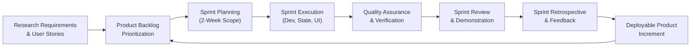
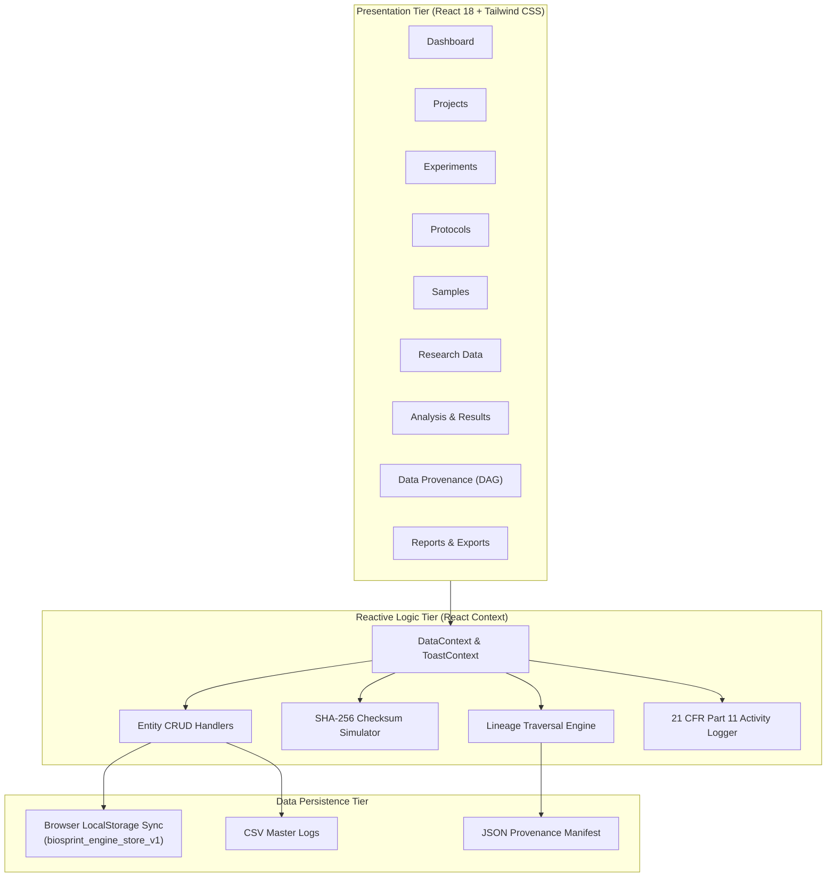

# BioSprint Engine: An Agile Orchestration and Data Provenance Platform for Reproducible Laboratory Workflows

## Slide 1 – Title Slide

### Presentation Overview
- **Project Title:** BioSprint Engine: An Agile Orchestration and Data Provenance Platform for Reproducible Laboratory Workflows
- **Presented by:** ANGULAKSHMI. S (Register No: 192524402)
- **Under the Guidance of:** Dr. S. SALINI
- **Department:** Department of Computer Science and Engineering
- **Institution:** Saveetha School of Engineering, SIMATS
- **Course Code & Name:** CSA1022 SOFTWARE ENGINEERING
- **Academic Year:** 2024 – 2026

---

## Slide 2 – Introduction

### Background and Context
- **Multidisciplinary Research Complexity:** Modern biological investigations integrate wet-lab experimentation, delicate biological specimens, standardized operating protocols, and dry-lab computational analyses.
- **Fragmentation of Experimental Records:** Research assets are historically maintained across disparate media, including paper bench books, standalone spreadsheets, isolated instrument computers, and ad-hoc scripts.
- **The Reproducibility Bottleneck:** Without explicit relational linkages between protocol revisions, sample aliquots, environmental parameters, and computational pipelines, independent scientific verification is severely impaired.
- **Need for Agile Laboratory Orchestration:** Biological research is inherently iterative; experimental hypotheses, reagent concentrations, and assay parameters evolve dynamically across iterative laboratory sprints.
- **The BioSprint Engine Solution:** A centralized, web-based platform engineered to orchestrate biological research workflows iteratively while compiling an immutable, cryptographic data provenance graph from planning to validated findings.

---

## Slide 3 – Objectives

### Project Objectives
1. **Agile Workflow Orchestration:**  
   To develop a modular web platform that orchestrates biological laboratory activities iteratively, enabling dynamic parameter configuration, protocol versioning, and sprint-based milestone tracking across research cycles.
2. **Relational Entity Integration:**  
   To establish a unified relational data architecture interconnecting research projects, Standard Operating Procedures (SOPs), cryogenic specimen coordinates, raw instrument datasets, and computational analyses.
3. **Data Provenance and Reproducibility:**  
   To implement an interactive Directed Acyclic Graph (DAG) and chronological audit trail conforming to FAIR data principles and FDA 21 CFR Part 11 guidelines for end-to-end experimental traceability.

---

## Slide 4 – Abstract

Biological research relies on tightly coupled lifecycles involving experimental design, standard operating procedures, physical specimen tracking, instrument data generation, and computational pipeline analytics. In conventional laboratory setups, these records remain fragmented across physical bench books, disjointed spreadsheets, and isolated analysis scripts, creating severe barriers to experimental reproducibility and regulatory auditability. To address this challenge, this project presents **BioSprint Engine**, an Agile orchestration and data provenance platform designed for reproducible laboratory workflows. Built as a high-performance web platform utilizing React 18, Vite, and Tailwind CSS, BioSprint Engine establishes a structured relational data model connecting research projects, assay execution parameters, cryogenic cold-chain samples, versioned protocols, multi-omics raw datasets, and computational results. The platform integrates an interactive Directed Acyclic Graph (DAG) provenance viewer and an immutable audit trail adhering to FAIR (Findable, Accessible, Interoperable, Reusable) data principles and FDA 21 CFR Part 11 guidelines. Developed using the Agile Scrum methodology across iterative sprint cycles, the platform is evaluated through functional verification, record-linking accuracy, and manifest integrity to provide an efficient, transparent, and reproducible operational foundation for modern life-science laboratories.

---

## Slide 5 – Problem Statement

### Core Research & Engineering Challenges
- **Siloed Research Activities:** Wet-lab sample preparation, instrument data capture, and dry-lab bioinformatics pipelines operate in isolated tool environments without unified data exchange.
- **Fragmented Research Records:** Protocols, freezer storage coordinates, instrument parameters, and output datasets lack persistent relational identifiers, leading to metadata loss.
- **Breakdown of Experimental Traceability:** Researchers face substantial difficulty retrospectively identifying which protocol revision, reagent catalog batch, or nucleofection parameter produced a specific published finding.
- **The Life Sciences Reproducibility Crisis:** Inability to independently replicate experimental results waste significant funding and labor across academic and clinical biotechnology domains.
- **Gaps in Existing Solutions:** Conventional Electronic Lab Notebooks focus on unstructured text documentation, whereas Laboratory Information Management Systems focus on barcode inventory, leaving a critical gap in visual, end-to-end data provenance tracking.

---

## Slide 6 – Literature Survey

### Review of Related Works

| S.No | Author & Year | Paper Title | Methodology / Contribution | Limitations Relevant to BioSprint Engine |
|:---:|:---|:---|:---|:---|
| 1 | **Agata D’Onofrio et al.** (2026) | [FairFlow: A Transparency-First Framework for Verifiable and Reproducible Bioinformatics](https://doi.org/10.1016/j.array.2025.100378) | Declarative Baryon specification and containerization (Docker) generating multi-platform workflows (Nextflow, Galaxy). | Focused strictly on computational pipeline execution; lacks physical laboratory experiment, sample, and SOP tracking. |
| 2 | **Daniel Pérez-Rodríguez et al.** (2026) | [Software Engineering for Reproducible Pipeline Development in Bioinformatics](https://doi.org/10.3389/fbinf.2024.1432104) | Software engineering principles (modularity, CI/CD, container isolation) applied to bioinformatics workflows. | Addresses dry-lab computational pipeline construction; does not encompass wet-lab specimen or bench record tracking. |
| 3 | **Rubaida Easmin et al.** (2026) | [IntegriLAB: A Blockchain-Enabled Electronic Lab Notebook for Reproducible Neuroimaging Research](https://www.researchgate.net/publication/IntegriLAB) | Blockchain-backed electronic laboratory notebook combining provenance verification with versioned repository tracking. | Specialized for neuroimaging datasets; blockchain overhead and domain specificity limit general molecular biology adaptability. |
| 4 | **Simon Schubotz et al.** (2025) | [Electronic Laboratory Notebook: An Adaptable Solution](https://doi.org/10.5334/jors.490) | Highly customizable modular electronic laboratory notebook architecture for research data documentation. | Requires complex technical domain customization and lacks native visual DAG provenance linking physical samples to raw data. |
| 5 | **Martin Starman et al.** (2025) | [ELNdataBridge: Facilitating Data Exchange and Collaboration by Linking Electronic Lab Notebooks via API](https://doi.org/10.1186/s13321-024-00912-3) | RESTful API middleware enabling automated data exchange and interoperability across heterogeneous ELN systems. | Focuses on inter-system communication; does not provide native end-to-end lifecycle orchestration or unified provenance manifests. |
| 6 | **Chia-Lin Lin et al.** (2025) | [Addressing Standardization and Semantics in an Electronic Lab Notebook for Multidisciplinary Use: LabIMotion](https://doi.org/10.1021/acs.jcim.4c01655) | Standardized semantic metadata modeling and domain-specific ontologies within an electronic notebook environment. | Semantic metadata standardization alone does not resolve operational workflow orchestration or provide visual lineage graphs. |

---

## Slide 7 – Existing Software and Drawbacks

### Comparative Analysis of Existing Laboratory Systems

| System Category | Representative Tools | Primary Capabilities | Identified Limitations | BioSprint Engine Advancement |
|:---|:---|:---|:---|:---|
| **Electronic Lab Notebooks (ELNs)** | eLabFTW, Benchling, LabArchives | Digital laboratory notes, unstructured narrative entry, protocol attachments. | Weak relational binding between freezer inventory, raw instrument files, and computational pipelines. | Relational data model binding protocols, specimens, assay parameters, and downstream analyses. |
| **Laboratory Information Management Systems (LIMS)** | OpenSpecimen, LabWare, Thermo SampleManager | Physical specimen accessioning, cold-chain storage mapping, diagnostic routing. | Cost-prohibitive, rigid configuration, and poor representation of dynamic computational analysis workflows. | Lightweight, highly responsive interface connecting specimen storage coordinates directly to analytical results. |
| **Bioinformatics Workflow Engines** | Nextflow, Galaxy, Snakemake | Scalable pipeline execution, containerized tool dependencies, cloud compute dispatch. | Completely detached from wet-lab bench execution, reagent lot numbers, and operator observations. | Bridges wet-lab experimental parameters directly to dry-lab computational pipeline results. |
| **Spreadsheets & General Cloud Storage** | Microsoft Excel, Google Sheets, Drive | Universal accessibility, flexible ad-hoc tables, low barrier to adoption. | Prone to human transcription errors, lacks relational integrity, no versioning, and zero provenance tracking. | Enforces relational integrity, automated activity logging, and client-side SHA-256 cryptographic hashing. |

---

## Slide 8 – Methodology

### Agile Scrum Framework Implementation
- **Agile Development Paradigm:** Adopted to accommodate changing laboratory requirements through rapid, iterative development cycles.
- **Product Backlog:** User stories derived from real-world laboratory workflows (project registration, protocol SOP locking, specimen accessioning, dataset hashing, lineage generation).
- **Sprint Planning & Sprints:** Organized into 2-week time-boxed sprints focusing on modular deliverables (UI Shell &rarr; Data Model &rarr; CRUD Workflows &rarr; Provenance Engine &rarr; Export Utilities).
- **Sprint Review & Stakeholder Feedback:** Evaluated against realistic molecular biology scenarios (CRISPR gene editing, spatial transcriptomics, nanobody selection).
- **Sprint Retrospective & Continuous Improvement:** Applied to refine UI responsiveness, optimize lineage graph rendering, and enhance data export formats.

### Agile Sprint Workflow Diagram

---

## Slide 9 – Module 1 – Requirements Analysis

### User Roles & System Requirements
- **Stakeholder Personas:**
  - *Principal Investigator (PI):* Supervises multi-disciplinary projects, reviews laboratory throughput, inspects audit streams, and signs off on certified research findings.
  - *Research Scientist / Lab Technician:* Manages standard operating procedures, accessions cryogenic samples, executes assays, and logs live bench observations.
  - *Bioinformatics Analyst:* Ingests raw sequencing/spectrometry files, executes computational pipelines, and binds analytical metrics to experiments.
  - *Compliance Auditor:* Reviews immutable 21 CFR Part 11 audit trails, verifies cryptographic SHA-256 checksums, and exports provenance manifests.
- **Functional Requirements:**
  - Dynamic CRUD management for projects, experiments, protocols, samples, datasets, analyses, and results.
  - Standard Operating Procedure (SOP) versioning (`v1.0` to `v3.2`) with reagent catalog binding and step-by-step procedures.
  - Physical sample tracking with exact storage coordinates (`-196°C LN2`, `-80°C`, `-20°C`, `4°C`).
  - Raw instrument dataset ingestion with simulated drag-and-drop upload and client-side SHA-256 hash generation.
  - Interactive Directed Acyclic Graph (DAG) visualizing end-to-end biological data provenance.
  - Instant client-side export of master CSV logs and FAIR/21 CFR Part 11 compliant JSON manifests.
- **Non-Functional Requirements:**
  - Sub-second UI response times for seamless operational navigation.
  - Client-side data persistence preserving state across browser sessions.
  - Compliance with FAIR data principles and FDA 21 CFR Part 11 electronic records standards.

---

## Slide 10 – Module 2 – System Design

### Architecture and Data Lineage Structure
- **Application Architecture:** Modern client-side Single Page Application (SPA) built with React 18, Vite 6, and Tailwind CSS.
- **State Management & Persistence:** Centralized React Context API (`DataContext`) maintaining reactive state synchronized with browser `localStorage` (`biosprint_engine_store_v1`).
- **Relational Entity Model:**
  - `Project` (1:N) &rarr; `Experiment` (1:1) &rarr; `Protocol SOP`
  - `Experiment` (1:N) &rarr; `Biological Samples`
  - `Experiment` (1:N) &rarr; `Parameters & Live Bench Observations`
  - `Experiment` (1:N) &rarr; `Raw Datasets (SHA-256)`
  - `Dataset` (1:1) &rarr; `Computational Analysis` (1:1) &rarr; `Validated Result`
- **Data Provenance Lineage Engine:**
  - Dedicated graph traversal function (`getProvenanceData`) dynamically builds an 8-node sequential lineage from parent-child foreign keys.

### System Architecture and Provenance Flow Diagram

---

## Slide 11 – Module 3 – Development and Implementation

### Working Implementation Across 10 Modules
- **Core Technology Stack:** React 18.3.1, Vite 6.0.3, Tailwind CSS 3.4.16, React Router DOM 6.28.0, Lucide React, and Recharts 2.15.0.
- **Implemented Operational Pages:**
  1. *Dashboard (`/dashboard`):* Real-time command center with KPI stat cards, Recharts status distributions, weekly assay throughput, and pending deadlines.
  2. *Research Projects (`/projects`):* Filterable multi-disciplinary program registry with status filters, principal investigator tracking, card/table toggles, and modal CRUD forms.
  3. *Experiments (`/experiments`):* Assay parameterization, protocol binding, live bench observation notes with timestamps, status tracking, and direct navigation to provenance.
  4. *Protocol Management (`/protocols`):* Standard Operating Procedure repository with step-by-step procedures, critical reagents directory, and immutable revision logs (`v3.2`).
  5. *Sample Management (`/samples`):* Biological specimen repository with exact cold-chain coordinates (`-196°C LN2`, `-80°C`, `-20°C`, `4°C`) and aliquot tracking.
  6. *Research Data (`/data`):* Multi-format dataset lake (`FASTQ`, `BAM`, `HDF5`, `mzML`) with simulated drag-and-drop upload and 64-character SHA-256 checksum generation.
  7. *Analysis & Results (`/analysis`):* Pipeline execution tracking (`CRISPResso2`, `CellRanger`, `Seurat`, `Biacore Insight`, `MS-DIAL`) with allele charts and certified results.
  8. *Data Provenance (`/provenance`):* Interactive 8-node Lineage DAG, 21 CFR Part 11 audit timeline, deep Provenance Inspector panel, and single-click JSON manifest export.
  9. *Reports (`/reports`):* Laboratory throughput metrics, storage volume distribution charts, and master CSV exports for experiments, samples, datasets, and audits.
  10. *Settings (`/settings`):* Principal investigator identity profile, default laboratory policies, storage quota monitoring, and baseline data reset.
- **Implementation Note:** All data operations run entirely on a client-side reactive store with browser persistence; no external backend server or database is deployed in the current repository.

---

## Slide 12 – Module 4 – Testing and Quality Assurance

### Verification Status & Quality Framework
- **Actual Testing Status:**
  - Functional exploratory verification conducted across all 10 user views and modal workflows.
  - Relational integrity verification ensuring foreign key linkages (`projectId`, `protocolId`, `sampleIds`, `datasetIds`) resolve accurately across all pages.
  - State persistence verification confirming entity modifications persist reliably across page refreshes via `localStorage`.
- **Quality Controls Implemented in Code:**
  - Defensive null-checking across graph traversal functions to prevent rendering crashes on incomplete records.
  - Destructive action confirmation dialogs (`ConfirmDialog`) preventing accidental record deletion.
  - Non-blocking toast alerts (`ToastContext`) providing instantaneous user feedback upon every successful CRUD transaction.
- **Proposed Evaluation Framework (Target Metrics for Evaluation Phase):**
  - *Record-Linking Accuracy:* Target 100% integrity across parent-child entities in the provenance chain.
  - *Metadata Completeness Rate:* Target 100% mandatory capture of protocol versions and cryptographic checksums.
  - *Client State Mutation Latency:* Sub-50ms execution for local client-side state transitions.
  - *Workflow Success Rate:* Verified across representative CRISPR, Single-Cell RNA-seq, and Metabolomics benchmark workflows.

---

## Slide 13 – Module 5 – Deployment and Results

### Deployment Execution, Results & Future Roadmap
- **Application Execution & Deployment:**
  - Development server executed via `npm run dev` on `http://localhost:3000`.
  - Production build compiled via Vite (`npm run build`) generating optimized HTML5, CSS3, and JavaScript bundles in `dist/`.
  - Directly deployable to static cloud hosting platforms (Netlify, Vercel, GitHub Pages) or containerized via an Nginx image.
- **Demonstrated Results:**
  - Successfully manages multi-disciplinary biological studies (e.g., *CRISPR-Cas9 Base Editing*, *Glioblastoma Spatial Transcriptomics*, *Nanobody Kinetics*, *Microfluidic LNPs*).
  - Generates interactive, click-to-inspect 8-node provenance graphs linking bench actions to computational results.
  - Produces compliant JSON provenance manifests adhering to FAIR principles and FDA 21 CFR Part 11 standards.
- **Current Limitations & Future Roadmap:**
  - *Current Limitation:* In-memory client storage (`localStorage`) is restricted to single-browser demonstration scope without multi-tenant authentication.
  - *Planned Enhancement 1:* Implement Python (FastAPI) backend with PostgreSQL database and JWT-based multi-user Role-Based Access Control (RBAC).
  - *Planned Enhancement 2:* Connect to real cloud object storage (AWS S3) and integrate automated Nextflow / Galaxy bioinformatics pipeline dispatch.
